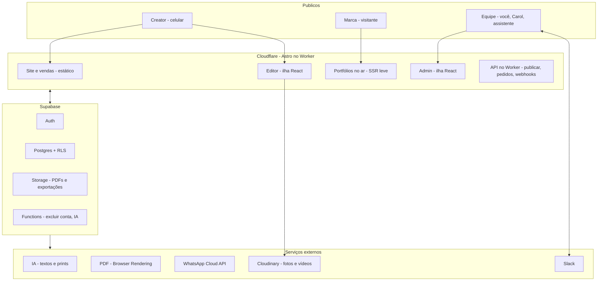

# Construtor do portfólio — nova abordagem

Atualizado em 23/out/2026. Substitui o plano antigo em que a creator mandava o material e a equipe montava o portfólio.

**Decisão de 27/out/2026: sem modelos.** Não há modelos para escolher nem trocar. A creator começa no editor com as seções de exemplo e monta o próprio portfólio adicionando, escondendo, removendo e reordenando seções (as seções montam qualquer template). O visual se ajusta na aba Estilo: cor (3 paletas prontas ou cor própria), fonte, cantos, claro ou escuro. "Nuvem" é só o nome do estilo padrão (`site/src/themes/modelos/nuvem.ts`). Onde este documento falava de modelos, o texto foi ajustado.

## Versão 1: o que fica de fora

Leitura de prints (OCR e IA), IA no assistente, entrar com Google e gateway de pagamento ficam para depois. Na versão 1 a creator digita os números com um guia, o assistente não usa IA e o login é só por código no e-mail. Onde este documento descreve essas partes, vale como plano futuro.

## A decisão

A creator monta o próprio site e portfólio num construtor no estilo Canva/Elementor, com **blocos prontos, paletas prontas e conteúdo de exemplo (placeholder) em tudo**, que ela troca pelo dela. Ela tem liberdade para montar, mas o visual fica sempre nas mãos do estilo, com as nossas travas de segurança.

- Tudo fica no repositório do site da Carol (Astro + Cloudflare).
- O pagamento continua manual: a Carol manda o link.
- O Claude Code deixa de ser obrigatório em cada pedido. O refino de texto vira um botão "Melhorar com IA" no editor.

Regra de ouro: **ela escolhe o "o quê", as seções e o estilo garantem o "como".** Liberdade em escolhas, nunca em valores (sem pixel, sem código de cor, sem CSS).

## O que ela pode criar

1. **Site**
2. **Mídia kit**
3. **Os dois juntos**

Os três saem da **mesma base de conteúdo**. Ela pode trocar o que quiser (paleta, fontes, cantos, claro ou escuro, formato, dados, ordem dos blocos) **sem perder nada do que ela mesma fez**:

- Trocar paleta ou estilo só muda a pele; o conteúdo vai junto.
- Trocar de formato (site, mídia kit ou os dois) não apaga blocos: o que não cabe no formato novo fica em **Guardados** e volta com um toque.
- Editar um dado (seguidores, bio, um vídeo) atualiza todas as saídas de uma vez: o site e o mídia kit, inclusive o PDF.
- O que ela escreveu nunca é substituído por placeholder ao trocar o estilo ou o formato. Placeholder só aparece onde ainda não tem conteúdo dela.

## Princípios de usabilidade

1. **A creator nunca sai do próprio portfólio.** Edita em cima do resultado final.
2. **Nunca tela em branco.** As seções já vêm preenchidas com exemplo e dicas da Carol.
3. **Tudo a um toque, nada escondido.** Sem pressionar e segurar, sem deslizar escondido.
4. **Nada se perde.** Desfazer em tudo e a bandeja de seções guardadas.
5. **Controles embaixo**, onde o polegar alcança.
6. **Um nível de profundidade.** Nunca uma gaveta dentro de outra.

## Três níveis de liberdade

**Nível 1: a página (liberdade total).** Adicionar, remover, reordenar, duplicar e devolver blocos.

**Nível 2: o bloco (liberdade guiada).** Variação de layout (grade, carrossel, destaque); fundo (cor da paleta, foto ou vídeo); alinhamento (esquerda ou centro); respiro (compacto, normal, amplo); um bloco por página pode ser "o principal".

**Nível 3: dentro do bloco (espaços prontos).** Título, texto, botão, imagem, etiqueta, número em destaque, ícone. Ela adiciona, tira e reordena dentro dos espaços; o bloco cuida de alinhamento e espaçamento.

**Estilo global.** Paleta, par de fontes (4 ou 5 opções que já combinam), cantos (retos, suaves, redondos) e clima (claro ou escuro).

## Blocos prontos

| Bloco | Variações |
| --- | --- |
| Capa | foto grande · vídeo de fundo · foto redonda centralizada |
| Sobre mim | texto + foto · só texto · nichos em etiquetas |
| Números | cards · barras comparando · destaque gigante de 1 número |
| Vídeos | carrossel · grade · 1 em destaque + lista |
| Marcas | logos · nomes em lista · com o resultado de cada publi |
| Público | idade · cidades · gênero |
| Formatos / pacotes | cards · tabela |
| Depoimento de marca | citação · print |
| Galeria de fotos | grade · mosaico |
| Contato | botões · formulário de briefing |
| Texto livre | para quando nenhum bloco encaixar |

As variações são de **layout**; a aba Estilo muda só a **pele** (cores, fontes, cantos, claro ou escuro). Um bloco bem feito funciona em qualquer combinação de estilo, e trocar o estilo não perde conteúdo.

**Um conteúdo, três saídas:** os blocos guardam dados, então o mesmo conteúdo gera o site, o mídia kit em PDF de 1 página e, depois, o link na bio.

## Paletas

- O estilo padrão vem com **3 paletas prontas**, e ela pode usar uma cor própria.
- **Regra própria para gerar a paleta a partir da cor principal** que a creator escolher: segue a regra de cor dinâmica do Material Design 3 (detalhes abaixo). Precisa gerar os papéis de cor (`--fundo`, `--superficie`, `--texto`, `--destaque`, `--apoio`) com contraste garantido em todo par de texto e fundo, com as contas em HCT, o espaço de cor do Material.
- Os blocos nunca usam cor direta, só os papéis.

### A regra: cor dinâmica do Material Design 3

A creator escolhe **uma cor** (ou tira da própria foto) e o sistema gera a paleta inteira com a mesma lógica do Material 3, usando a biblioteca oficial do Google `@material/material-color-utilities`.

**1. Espaço de cor HCT.** Toda cor vira Matiz (H), Croma (C, intensidade) e Tom (T, claridade de 0 a 100). O Tom é calibrado para contraste: dois tons com diferença de 40 garantem contraste de pelo menos 3:1, e diferença de 50 garante 4,5:1 (o mínimo para texto). É isso que faz a trava de contraste funcionar sozinha.

**2. Da cor principal saem 5 famílias**, cada uma com tons de 0 a 100:

| Família | Como nasce |
| --- | --- |
| Primária | a matiz da cor dela |
| Secundária | a mesma matiz, bem menos intensa |
| Terciária | a matiz girada (cor de apoio que combina) |
| Neutra | quase sem cor, para fundos e textos |
| Neutra variante | um pouco mais de cor, para bordas e textos suaves |

**3. Os papéis de cor são tons fixos dessas famílias**, e é por isso que qualquer cor dá certo:

| Nosso papel | Papel no Material | Claro | Escuro |
| --- | --- | --- | --- |
| `--destaque` | primary | tom 40 | tom 80 |
| `--sobre-destaque` | onPrimary | tom 100 | tom 20 |
| `--destaque-suave` | primaryContainer | tom 90 | tom 30 |
| `--apoio` | tertiary | tom 40 | tom 80 |
| `--fundo` | surface | neutra 98 | neutra 6 |
| `--superficie` | surfaceContainer | neutra 94 | neutra 12 |
| `--texto` | onSurface | neutra 10 | neutra 90 |
| `--texto-suave` | onSurfaceVariant | variante 30 | variante 80 |
| `--borda` | outlineVariant | variante 80 | variante 30 |

**4. Fidelidade à cor dela.** O esquema padrão do Material (Tonal Spot) desbota a cor escolhida. Para creator, a cor é identidade, então usamos o esquema **Fidelity** (ou **Content**), que mantém a intensidade da cor original. Outros esquemas (**Vibrant**, **Neutral**) ficam como opção futura do Estilo, se fizer sentido. (Antes cada modelo teria o seu esquema; descartado em 27/out/2026 junto com os modelos.)

**5. Tirar a cor da foto.** A mesma biblioteca extrai a cor dominante de uma imagem (quantização + pontuação). Botão "Usar a cor da minha foto" na aba Estilo.

**6. As 3 paletas prontas** passam a ser 3 cores de origem com a mesma regra. Tudo vira um sistema só: paleta pronta e cor dela geram os mesmos papéis.

**7. Contraste extra.** A biblioteca tem níveis de contraste (padrão, médio, alto); usamos o padrão e subimos só se a conferência de acessibilidade pedir.

Os blocos nunca usam cor direta: só os papéis acima, como variáveis CSS. Trocar a cor recalcula as variáveis e a página inteira muda na hora.

## Placeholders: tudo pronto, tudo trocável

- Texto, foto, vídeo e números de exemplo em tudo, escritos no tom da Carol, para a creator entender o que vai em cada espaço só de olhar.
- Etiqueta discreta "Exemplo · toque para trocar", que some quando ela troca.
- "Remover" sempre ao lado de "Trocar".
- **Placeholder nunca vai para o ar:** cada um que sobrou vira alerta na revisão final; número de exemplo bloqueia a publicação.
- Progresso no topo: **"7 de 12 itens já são seus"**.

## Travas de segurança

| Ela pode | A trava |
| --- | --- |
| Escolher a cor principal | A regra de paleta garante contraste; se não der, o texto vira preto ou branco sozinho |
| Escrever títulos e textos | Limite de letras por espaço, com aviso; a fonte nunca diminui |
| Subir qualquer foto | Corte automático no formato do espaço, foco no rosto, aviso de foto escura ou baixa resolução |
| Subir vídeos | Limites de duração e tamanho a definir (conforme o Cloudinary); convertidos e comprimidos sozinhos, capa automática |
| Montar a página como quiser | Capa e Contato obrigatórios (podem mudar de lugar, não sair); máximo de uns 15 blocos |
| Colocar números | Ela informa com o período; selo "informado pela creator"; número de exemplo nunca publica |
| Editar no celular ou no computador | Uma versão só; o layout do celular é sempre gerado, sem ajuste separado |
| Botões e links | Link testado na hora; WhatsApp e e-mail validados |
| Publicar | Revisão final: alertas amarelos ela pode ignorar, vermelhos bloqueiam |

Nunca aparece para ela: campo de margem, tamanho de fonte em número, código hexadecimal, posição livre, CSS.

## A jornada no celular

1. **Escolher as cores (30 s):** "Escolha suas cores", as 3 paletas com nome e amostra acima da prévia da página, botão "Usar estas cores".
2. **O assistente (2 min, ver "Diferenciais"):** nome, @, nicho e "Já fez alguma publi?". "Ainda não" liga o modo iniciante. O portfólio aparece com o nome dela na capa.
3. **O editor:** no próprio portfólio rolando; tocar numa seção mostra a barrinha Editar · ↑ · ↓ · Esconder; "+" entre seções; barra fixa Seções · Estilo · Ver · Publicar; "Salvo ✓" e progresso no topo.
4. **Editar texto ou foto:** gaveta de baixo com o campo focado, mudança ao vivo, contador de letras, dica da Carol, "Melhorar com IA".
5. **Painel Seções:** visíveis com setas ↑↓, guardadas com "Devolver", "+ Adicionar seção" com miniaturas.
6. **Estilo:** paletas e cor própria, fonte, cantos, claro ou escuro, troca instantânea com "Desfazer".
7. **Vídeos e fotos:** da galeria, envio em segundo plano com barra no próprio card, avisos claros.
8. **Números:** ela digita, com um guia de onde achar cada número no Insights. (Depois: "Tirar dos meus prints".)
9. **Ver:** some a interface, aparece como a marca vai ver.
10. **Publicar:** revisão guiada (7 itens), escolha do link `/nome`, plano, tela de status.

```
┌─────────────────────────┐
│ ‹  Salvo ✓   7 de 12 seus │
├─────────────────────────┤
│   [ foto ]                │
│   Oi, eu sou a Joana      │
│   @joana · Recife         │
│ ┌ ─ ─ ─ ─ ─ ─ ─ ─ ─ ─ ─ ┐ │
│   Meus vídeos             │
│   [▶][▶][+ adicionar]     │
│ └ ─ ─ ─ ─ ─ ─ ─ ─ ─ ─ ─ ┘ │
│    Editar  ↑  ↓  Esconder  │
│           ( + )           │
├─────────────────────────┤
│ Seções Estilo Ver Publicar│
└─────────────────────────┘
```

Detalhes: salva sozinho e funciona com internet ruim (fila de envio); áreas de toque de 44 px no mínimo; cada seção vazia mostra um exemplo; o progresso aponta o próximo passo; frases curtas, em "você".

## Fluxo de publicação

1. A creator monta o portfólio no editor (prévia com marca d'água).
2. Toca em **Publicar** → card no Slack: "Joana quer publicar, plano X".
3. A Carol cola o link de pagamento na thread → o bot manda para o WhatsApp da creator.
4. A Carol marca **Pago** → o portfólio vai para o ar de verdade, PDF liberado, aviso no WhatsApp.

O "pedir ajuste" e a produção no Claude Code saem do fluxo.

## Arquitetura no repositório



O Cloudflare serve tudo o que é página (site, editor, admin e os portfólios publicados) e a API; o Supabase guarda login, dados e arquivos. A equipe opera pelo Admin no dia a dia e recebe os avisos e ações rápidas no Slack.

- **Editor:** ilha interativa no Astro com **React**.
- **Uma renderização só:** os blocos são componentes React usados no editor e na página publicada (gerada no servidor pelo Worker).
- **Bibliotecas do editor:** Puck (avaliar em 1 a 2 dias como base do modelo de blocos, com interface própria para celular), dnd-kit (reordenar no toque), Vaul (gaveta), Motion (animações), Zustand + zundo (estado, salvar sozinho, desfazer), Uppy + TUS (upload com retomada), Radix/shadcn (componentes acessíveis).
- **Por que React:** o código será escrito por IA, guiada por nós; React tem o maior ecossistema para construtores visuais e é o que os modelos conhecem melhor.
- **PDF do mídia kit:** Cloudflare Browser Rendering a partir da mesma página.
- **Dados:** Supabase (Postgres) com um JSON por projeto, protegido por RLS (cada creator só enxerga o que é dela); fotos e vídeos no Cloudinary (a conta que já usamos no site da Carol), que também converte HEIC e .mov, comprime e gera as capas; o Supabase Storage guarda só PDFs e exportações.
- **Login sem senha:** Supabase Auth com código de 6 dígitos por e-mail. Google e código por WhatsApp depois.
- **Link publicado:** `/c/<slug>` agora, `portfoliocreator.com.br/<slug>` quando o domínio existir.

```ts
{ modelo: 'nuvem', // valor interno fixo, não é escolha da creator (sem modelos desde 27/out/2026)
  paleta: 2, fontes: 'par-1', cantos: 'suaves',
  blocos: [
    { id: 'b1', tipo: 'capa', variacao: 'foto-grande', oculto: false, dados: {...} },
    { id: 'b2', tipo: 'videos', variacao: 'carrossel', oculto: false, dados: {...} },
  ] }
```

## Área logada

A creator tem uma conta (Supabase Auth) e uma área só dela.

**Entrar, pensado para o celular:**

- Sem senha: ela digita o e-mail e recebe um **código de 6 dígitos**. Código funciona melhor que link mágico no celular, porque o link abre no app de e-mail e perde a sessão.
- Sessão longa: ela não precisa entrar de novo a cada visita.
- A conta pode nascer **depois** das 3 perguntas: ela começa a montar, e na hora de salvar pede o e-mail. O rascunho feito antes vai junto.

**O que tem na área logada:**

- **Meus projetos:** site, mídia kit ou os dois, com miniatura, status (rascunho, aguardando pagamento, no ar) e botão Editar.
- **Editor:** o construtor.
- **Publicação:** link `/nome`, copiar link, baixar o PDF do mídia kit.
- **Plano e pagamento:** plano escolhido, status do pagamento, validade.
- **Minhas mídias:** vídeos e fotos já enviados, para reaproveitar em qualquer projeto, com o espaço usado.
- **Conta:** nome, @, WhatsApp, e-mail, excluir conta e baixar meus dados (LGPD).

**Sair: excluir a conta e os dados**

Fica em **Conta → Excluir minha conta**, fácil de achar e sem truque para segurar a creator (direito garantido pela LGPD).

1. **Antes de excluir, opções mais leves:** tirar um projeto do ar, excluir só um projeto ou só algumas mídias. Aparecem como alternativa, nunca como obstáculo.
2. **Baixar meus dados:** botão para baixar um .zip só com os dados e informações dela: textos que ela escreveu, fotos e vídeos que ela enviou, dados da conta e histórico de pedidos. Nunca os produtos: site, estilos, blocos e PDF do mídia kit não entram no .zip.
3. **O que será apagado, em lista clara:** site e mídia kit saem do ar, o link `/nome` fica livre, fotos e vídeos, perfil, login.
4. **O que fica guardado:** só o que a lei obriga (registro dos pagamentos), pelo prazo legal, sem fotos, vídeos nem conteúdo.
5. **Confirmação:** um código de 6 dígitos no e-mail, igual ao login, para ninguém apagar a conta de outra pessoa.
6. **Prazo para voltar atrás:** a conta fica desativada por 7 dias (tudo fora do ar) e pode ser recuperada entrando de novo. Depois disso, a exclusão é definitiva.
7. **Aviso final:** e-mail confirmando a exclusão; card no Slack para a equipe saber (e cancelar assinatura ativa, se houver).

No Supabase, uma função do servidor apaga a pasta da creator no Cloudinary e no Storage, as linhas dela no banco e o usuário do Auth, nessa ordem.

**Tabelas principais (rascunho):**

| Tabela | Guarda |
| --- | --- |
| `profiles` | nome, @, WhatsApp, cidade, nicho, modo iniciante |
| `projects` | tipo (site, mídia kit, os dois), modelo (valor interno fixo `'nuvem'`; a coluna é `not null` e o `projetoSchema` exige o campo; removê-la fica para uma migração futura), paleta, blocos (JSON), slug, status |
| `media` | arquivos da creator: tipo, tamanho, duração, capa |
| `orders` | plano, status do pagamento, link enviado pela Carol, data |

O Slack continua sendo o painel da equipe: quando a creator toca em Publicar, o pedido entra em `orders` e o card aparece no Slack.

## Área da creator: a ideia e o que ela pode fazer

### A ideia

A área da creator é o "lugar dela" no produto. Ela abre o app e em 2 segundos sabe **onde está e qual é o próximo passo**. Tudo gira em torno de uma pergunta: "o meu portfólio está pronto para mandar para uma marca?"

- **Início** abre sempre num cartão grande com o próximo passo ("Troque os 3 vídeos de exemplo", "Seu pagamento foi confirmado, publique!", "Seu link está no ar, copie para a bio"), mais o status dos pedidos e as dicas da Carol.
- **Projetos** lista o site, o mídia kit ou os dois, com miniatura, status e um botão principal que muda conforme o momento (Continuar editando, Publicar, Copiar link).
- **Editor** abre em tela cheia por cima de tudo; o botão de voltar leva de volta para Projetos, sempre com o "Salvo ✓".
- **Mídias** é a biblioteca dela: o que subiu uma vez serve para qualquer projeto.
- **Conta** reúne dados, plano, pagamentos e os direitos dela (baixar dados, excluir conta).

### Os estados de um projeto

Rascunho → Aguardando pagamento → No ar → (sem plano de edição) Edição travada → (se ela quiser) Fora do ar.

- **Edição travada não tira nada do ar:** o portfólio continua publicado e tudo que ela fez continua salvo. Ela só não muda até liberar a edição de novo.
- Ela mesma pode tirar do ar e pôr de volta quando quiser.

### O que ela pode fazer, por momento

Os nomes e preços dos planos serão definidos depois; a tabela usa os momentos da creator.

| Ação | Sem conta | Conta grátis (teste) | Pagou | Pagou + edição liberada |
|---|---|---|---|---|
| Montar no editor | sim, rascunho no aparelho | sim | sim | sim |
| Paletas, cor própria e cor da foto | sim | sim | sim | sim |
| Subir fotos e vídeos | não, pede a conta | sim, dentro do limite | sim | sim |
| IA nos textos e nos prints (depois da versão 1) | não | limitada (quantidade a definir) | sim | sim |
| Ver a prévia | sim | com marca d'água | sem marca d'água | sem marca d'água |
| Publicar o link `/nome` | não | não | sim | sim |
| Baixar o PDF do mídia kit | não | sim, com marca d'água | sim | sim |
| Levar o site para outro lugar (baixar os arquivos) | não | não | pagando o mesmo valor do mídia kit | pagando o mesmo valor do mídia kit |
| Editar depois de publicar | não se aplica | não se aplica | até concluir + 7 dias | sempre |
| Trocar paleta e estilo | sim | sim | durante a edição | sempre |
| Domínio próprio `.com.br` | não | não | com o plano Site | com o plano Site |
| Tirar do ar e pôr de volta | não se aplica | não se aplica | sim | sim |
| Baixar meus dados e excluir conta | não se aplica | sim | sim | sim |

- **Exemplos e PDF na conta grátis:** ela pode baixar, mas sempre com marca d'água, para impedir o uso gratuito do mídia kit.
- **Hospedagem:** o site publicado fica hospedado com a gente. Para levar para outro lugar, ela paga o mesmo valor do mídia kit e baixa os arquivos do site.
- **Premium liberado pela equipe:** pelo Admin, a equipe pode liberar (ou não) uma creator como Premium em cada um dos 3 moldes: **Site**, **Mídia kit** ou **os dois**. Premium vale como a coluna "Pagou + edição liberada" daquele molde, sem passar pelo pagamento (por exemplo, alunas do curso da Carol ou parcerias). Tem validade opcional, motivo obrigatório e entra no Registro de ações.

### O que ela sempre pode, em qualquer momento

- Ver tudo o que já fez: nada some porque o plano acabou.
- Baixar os dados dela e excluir a conta.
- Falar com a equipe pelo WhatsApp.
- Tirar o portfólio do ar.

### O que ela nunca pode

- Mexer em código, CSS, margens, tamanhos em número ou posição livre.
- Publicar com placeholder (exemplo) que não trocou, principalmente números.
- Tirar a marca d'água sem pagar.
- Baixar o estilo e os blocos soltos. Levar o site para outro lugar só pagando o valor do mídia kit.
- Usar um link `/nome` reservado ou de outra creator.
- Ver ou mexer em dados de outra creator, ou em pedidos e pagamentos (só vê os dela).
- Publicar conteúdo proibido pelos Termos (a equipe pode tirar do ar pelo Admin).

### Limites por conta

- Confirmado: 1 site e 1 mídia kit por conta (ou os dois juntos), com 1 link `/nome`.
- Vídeos, fotos e espaço por conta: a definir, conforme o plano do Cloudinary.
- Máximo de uns 15 blocos por página.

### Avisos que ela recebe

No app (Início) e no WhatsApp: pedido recebido, link de pagamento, pagamento confirmado, portfólio no ar, edição perto de travar (2 dias antes), conta desativada, conta excluída e marca abriu o portfólio.

## Área administrativa

O Slack fica para **avisos e ações rápidas** (novo pedido, marcar Pago). O Admin é onde a equipe **gerencia** o produto. Fica no mesmo repositório, em `/admin`, como outra ilha React, com login pelo mesmo Supabase Auth e acesso só para quem tem papel de equipe.

**Papéis:** admin (tudo), operação (pedidos, creators, suporte) e assistente (publicar sites com domínio e suporte).

**Segurança:** o papel fica gravado no usuário do Supabase (só o servidor altera) e o RLS libera as tabelas para a equipe a partir dele; login da equipe com verificação em duas etapas; toda ação que muda dado de creator entra no Registro de ações. Ver o portfólio de uma creator é sempre só leitura.

| Tela | O que faz |
|---|---|
| Painel | vendas do mês, creators novas, portfólios publicados, pedidos aguardando pagamento |
| Pedidos | lista com filtros por status, link de pagamento, marcar Pago, histórico do pedido |
| Creators | busca, perfil, projetos, plano, contato no WhatsApp; ver o portfólio como ela vê (só leitura); liberar ou tirar Premium por molde, com validade e motivo |
| Portfólios no ar | lista, abrir, tirar do ar em caso de denúncia ou problema |
| Blocos e paletas | editar placeholders e dicas da Carol |
| Planos e cupons | preços, cupom de lançamento, validade |
| Exclusões (LGPD) | contas desativadas nos 7 dias, exclusões concluídas, pedidos de dados |
| Uso do editor | onde as creators param, blocos mais usados, tempo até publicar |
| Registro de ações | quem da equipe fez o quê e quando |
| Mensagens | avisos de WhatsApp enviados, entregues ou com erro, reenviar |
| Mídias e espaço | espaço por creator, arquivos maiores, arquivos sem projeto |
| Configurações | canal do Slack, número do WhatsApp, textos dos avisos, prazos |

**Stack do Admin:** Refine (conector oficial do Supabase) + shadcn/ui + TanStack Table + React Hook Form + Zod + Recharts. No lançamento, o Supabase Studio serve de admin provisório.

**Ordem do admin:** Supabase Studio no lançamento → Pedidos e Creators no Refine → Painel, Blocos e Exclusões → o resto conforme a operação pedir.

## Elementor: o que pegamos e o que fica de fora

**Pegamos:** biblioteca de blocos com miniatura, navegador da página (painel Seções), cores e fontes globais, histórico/desfazer, blocos salvos, aba Conteúdo e um pouco da aba Estilo.

**Fica de fora:** aba Avançado, margens e espaçamentos, containers livres aninhados, edição pensada para o computador, ajustes separados por tamanho de tela.

## Escopo do lançamento

- 11 seções com variações (o PRD falava em 8 blocos com 2 variações cada).
- Um estilo padrão (Nuvem) com 3 paletas prontas e cor própria; fonte, cantos e claro/escuro na aba Estilo. Sem modelos (os 5 do lançamento e os outros 10 foram descartados em 27/out/2026).
- Ordem: seções no estilo padrão com o editor funcionando → teste no celular.

## Diferenciais e crescimento

### Métrica de sucesso

- **Principal:** creators que publicaram e tiveram o portfólio **aberto por pelo menos 1 marca**.
- **Resultado:** publis fechadas. Botão "Fechei uma publi!"; com a permissão dela, vira depoimento real (nada inventado).
- **Saúde do negócio:** conversão do teste grátis para o pago.

### Assistente que monta o portfólio

As seções resolvem a estrutura, o Estilo resolve o visual e o assistente resolve o conteúdo.

1. Nome, @, cidade e nicho.
2. "Já fez alguma publi?" ("ainda não" liga o modo iniciante).
3. "O que você mais gosta de gravar?" e "Uma frase que é a sua cara".
4. Vídeos (da galeria) e prints do Instagram.

Na versão 1, as respostas dela, os vídeos e os números que ela informar entram direto nos blocos (depois: a IA escreve a bio e os números vêm dos prints). Ela chega ao editor com a maior parte do portfólio já sendo dela. Placeholder só aparece onde faltou informação.

### Aviso de abertura

1. Ela toca em **Mandar para uma marca** e digita o nome ("Padaria X").
2. O sistema cria um link só para essa marca: `/joana/k3f9`, com o código guardado como "Padaria X".
3. Ela copia a mensagem pronta já com o link e manda por DM, e-mail ou WhatsApp.
4. Quando o link é aberto, ela recebe no app e no WhatsApp: "A Padaria X abriu seu portfólio".

Regras: filtrar as prévias automáticas (só conta navegador de verdade); a própria creator não conta; link repassado conta como a mesma marca; o link da bio, sem código, só conta visitas; registramos só que "o link da Padaria X foi aberto", sem identificar quem abriu; lista "Marcas" na área da creator.

### Revisão da Carol (pago)

A Carol (ou a assistente, seguindo o roteiro dela) olha o portfólio e manda 3 ajustes num áudio de WhatsApp. Preço e prazo a definir.

### Selo "Feito com Portfólio Creator"

Todo portfólio publicado e todo PDF levam um selo discreto com link para a página de vendas. Remover o selo pode ser um benefício de plano (a definir).
